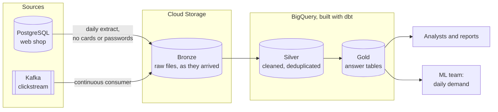

# Architecture

> Update this page at the end of every lesson. It is the diagram you present at
> the oral defence.

## Context

Albert's Marketplace is a European beauty marketplace whose web shop runs on one
PostgreSQL database, which the analysts also query directly. Its reports
disagree on revenue, it keeps no history, and its saved cards and passwords sit
in the tables the analysts read. The analysts need reports they can trust, and
the ML team needs units sold per product, per country, per day, refreshed
daily. The platform must take the analytical load off the shop's database,
keep every raw extract, and never copy the secrets out of the source.

## Target architecture

The choice of a two-tier platform is recorded in
[ADR-0001](adr/0001-target-architecture.md).

## Layers

| Layer | What lands here | What it guarantees | Who reads it |
|---|---|---|---|
| Bronze | Raw extracts of the shop's tables and the clickstream events, unchanged, as files in Cloud Storage | Nothing that arrived is lost, and nothing is changed: any later layer can be rebuilt from it | The pipelines only |
| Silver | Cleaned tables in BigQuery: typed, one row per business entity, duplicated orders resolved, no secrets | One agreed version of each fact | Data engineers, analysts exploring |
| Gold | Answer tables in BigQuery, such as daily demand per product and country | Answers one named question, with a declared grain and tests | Analysts, reports, the ML team |

## Decisions

| ADR | Decision | Status |
|---|---|---|
| [0001](adr/0001-target-architecture.md) | Two-tier: raw files in Cloud Storage, modelled layers in BigQuery | Accepted |

## Change log

| Lesson | What changed |
|---|---|
| L01 | First version |
