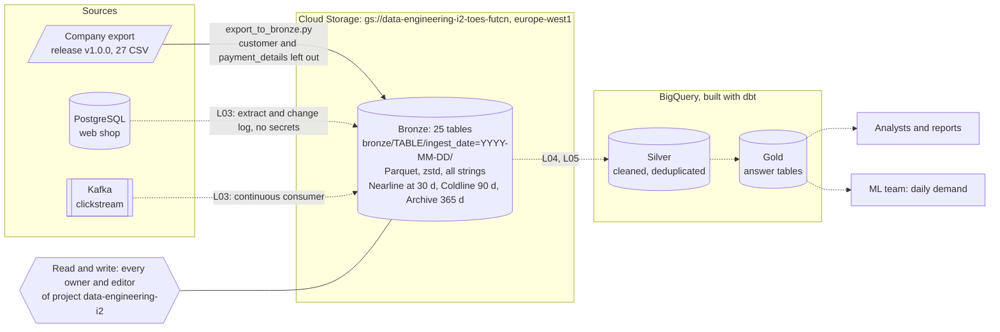

# Architecture

> Update this page at the end of every lesson. It is the diagram you present at
> the oral defence.

## Context

Albert's Marketplace is a European beauty marketplace whose web shop runs on one
PostgreSQL database, which the analysts also query directly. Its reports
disagree on revenue, it keeps no history, and its saved cards and passwords sit
in the tables the analysts read. The analysts need reports they can trust, and
the ML team needs units sold per product, per country, per day, refreshed
daily. The platform must take the analytical load off the shop's database,
keep every raw extract, and never copy the secrets out of the source.

## Architecture

Solid lines exist today; dashed lines are planned.

The two-tier platform is [ADR-0001](adr/0001-target-architecture.md); the
bronze layout is [ADR-0002](adr/0002-bronze-layout.md). Who can read the
bucket, and why that is too many people, is in [infra/iam.md](../infra/iam.md).

## Layers

| Layer | What lands here | What it guarantees | Who reads it |
|---|---|---|---|
| Bronze | Raw extracts of the shop's tables and the clickstream events, unchanged, as zstd Parquet in `gs://data-engineering-i2-toes-futcn`, one partition per load | Nothing that arrived is lost, and nothing is changed: every value is the string the source wrote, and any later layer can be rebuilt from it. No credentials or card data | The pipelines only (today, every editor of the project: see [infra/iam.md](../infra/iam.md)) |
| Silver | Cleaned tables in BigQuery: typed, one row per business entity, duplicated orders resolved, no secrets | One agreed version of each fact | Data engineers, analysts exploring |
| Gold | Answer tables in BigQuery, such as daily demand per product and country | Answers one named question, with a declared grain and tests | Analysts, reports, the ML team |

## Decisions

| ADR | Decision | Status |
|---|---|---|
| [0001](adr/0001-target-architecture.md) | Two-tier: raw files in Cloud Storage, modelled layers in BigQuery | Accepted |
| [0002](adr/0002-bronze-layout.md) | Bronze as zstd Parquet, all strings, partitioned by ingest date; no secrets landed | Accepted |

## Change log

| Lesson | What changed |
|---|---|
| L01 | First version |
| L02 | The bronze bucket exists: its name, region, layout, lifecycle and access are on the diagram. Planned parts are dashed |
