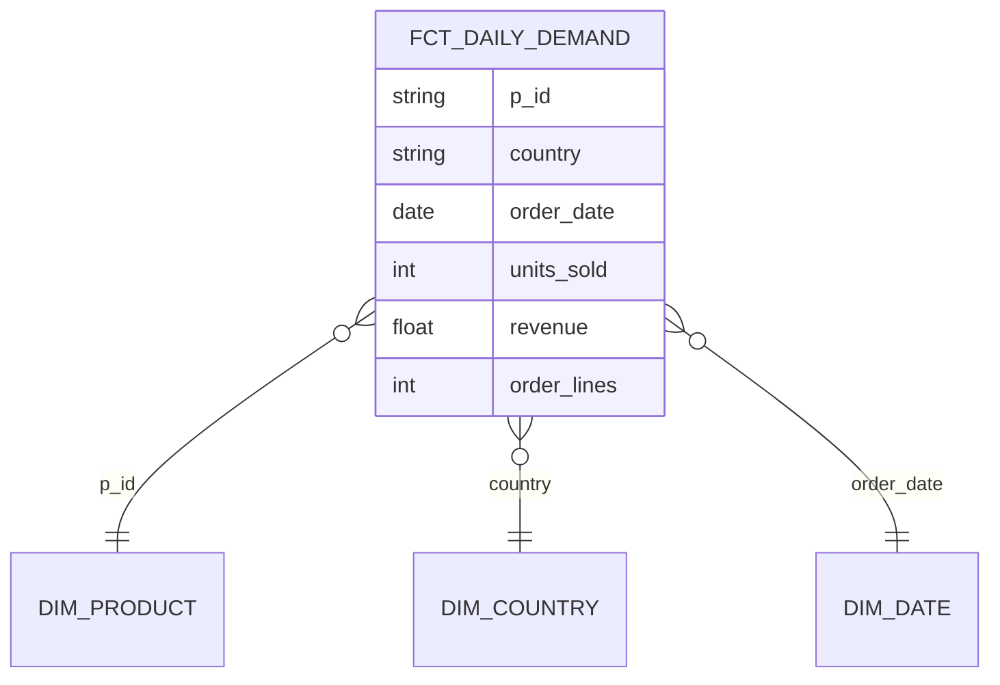

# Star schema: daily demand

The table the ML team asked for: units sold per product, per country, per day.

## 1. Business process

**Sales**: a customer buys products, recorded as order lines (one product in
one order, with a quantity and the price paid).

## 2. Grain

**One row per product, per country, per day.**

## 3. Dimensions

| Dimension | What it holds | Where it comes from |
|---|---|---|
| `dim_product` | Product identifier, name, category | `product`, `category` |
| `dim_country` | Country | The customer's default shipping address: `customer_shipping` → `shipping_details` |
| `dim_date` | Day, week, month, year | `order_date` on the order |

The seller cannot be a dimension at this grain: an order line does not record
which seller sold the product.

## 4. Facts

| Fact | Definition | Additive? |
|---|---|---|
| `units_sold` | Sum of `qty` over the day's order lines | Yes, across every dimension |
| `revenue` | Sum of `qty × price_at_purchase` | Yes, across every dimension |
| `order_lines` | Number of order lines | Yes |

## What the platform must carry from the first ingestion

- **`order_items`**: `order_id`, `p_id`, `qty`, `price_at_purchase`.
- **`orders`**: `order_id`, `buyer_id`, `order_date`. The order line has no date of its own.
- **`customer_shipping`** and **`shipping_details`**: `c_id`, `address_id`, `is_default`, `country`. Country lives on the address, not on the order.
- **`product`** and **`category`**: `p_id`, `category_id`, and the category name.

Orders are duplicated in the source: they must be resolved in silver before
this table counts anything.
