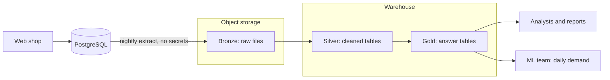

# Session 1 — Exercise 1: diagnose Albert's Marketplace

## The brief

Customers use the web shop, which writes to one PostgreSQL database. Analysts query that database directly, and a nightly CSV export feeds spreadsheets.

What we know, from the lecture and the diagram:

- One PostgreSQL database, 25 tables, serving both the shop and the analysts.
- The analysts query it directly, and a nightly CSV export feeds their spreadsheets.
- The database holds orders, customers, products and reviews, and also saved cards and passwords.
- The reports disagree on revenue.
- The ML team wants units sold per product, per country, per day.

## 1. The data flows

| # | Source | Data | Consumer | Frequency | Format |
|---|--------|------|----------|-----------|--------|
| 1 | Web shop (checkout) | Orders, lines, payments, stock | PostgreSQL database | Continuous | Database writes |
| 2 | Web shop (reviews) | Ratings, review texts, photo links | PostgreSQL database | Continuous | Database writes |
| 3 | PostgreSQL database | Orders, customers, products | Analysts | On demand | SQL queries |
| 4 | PostgreSQL database | Selected tables | Spreadsheets | Nightly | CSV export |
| 5 | (Wanted) daily demand | Units per product, country, day | ML team | Daily | Does not exist yet |

## 2. The classification

None of the four. It is an operational database used for analytics: it does not integrate several sources, it keeps no history, and its model is built to record orders rather than to aggregate them.

## 3. Four problems, with evidence

| # | Problem | Evidence |
|---|---------|----------|
| 1 | Analytical load on the shop's database | The analysts' reports scan the same tables checkout writes to. |
| 2 | Figures that disagree | The reports disagree on revenue: orders are duplicated, and each report handles the duplicates its own way. |
| 3 | No history | The database holds only the current state, so last March's price is gone. |
| 4 | Sensitive data beside analytical data | Saved cards and passwords sit in the tables the analysts query. |

Two more that the brief also supports: reporting is manual (a nightly CSV opened by hand), and nothing exists for the ML team (daily demand is not computed anywhere).

## 4. The target architecture

**Choice:** a two-tier architecture — object storage for the raw files, plus a warehouse for the modelled layers — organised bronze, silver, gold.

**Justification, from the decision frame:**

| Criterion | What the brief says | What it decides |
|-----------|---------------------|-----------------|
| Workload | Reports and machine learning | Both SQL tables and files must be served |
| Data types | Structured orders and free review text | Raw files in object storage, modelled tables in the warehouse |
| Freshness | Daily is enough | Batch loads; nothing needs streaming |
| Team and skills | A small team | Managed services rather than self-run clusters |
| Governance | Personal data, cards and passwords | Secrets never leave the source |

**What each layer guarantees:**

- **Bronze:** nothing that arrived is lost.
- **Silver:** one agreed version of each fact, and no secrets.
- **Gold:** answers a named question.

## 5. The ML team's table

For "units sold per product, per country, per day":

- **Grain:** one row per product, per country, per day.
- **Facts:** units sold, revenue.
- **Dimensions:** product (with its category), country, date.

The seller cannot be a dimension at this grain: an order line does not record which seller sold the product.

## Summary in five sentences

1. **Classification:** what exists is none of the four architectures, but an operational database used for analytics, with no integration, no history and a model built to record orders.
2. **Problem 1:** analytical queries run on the shop's own database, because the reports scan the tables checkout writes to.
3. **Problem 2:** the reports disagree on revenue, because orders are duplicated and each report handles them differently.
4. **Problems 3 and 4:** there is no history, since only the current state is kept, and saved cards and passwords sit in the tables the analysts query.
5. **Choice:** a two-tier architecture with bronze, silver and gold layers, decided by the mixed workload (reports and ML), the mix of structured orders and review text, and daily freshness being enough.
