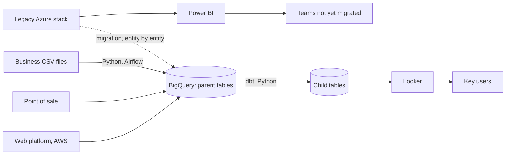

# Session 1 — Exercise 2: Cartier's data platform, diagnosis and 12-month path

LUBERNE Féliz — written as a group, from the analytics team at Cartier, where one of us is an apprentice analytics engineer. We describe systems and flows, never data, and give no internal figure.

## 1. What exists today

For a little over a year, most of Cartier's teams have been moving from Azure, and the Microsoft stack in general, to Google Cloud. The analytics team, where we work, is the flagship of that migration. Our job is to build MVPs on GCP and show that they work, so that management can then require every dev and digital squad to decommission Azure. Until that happens, both worlds run side by side: the web development team in France builds on AWS, part of the business still reads its reports from the Azure stack in Power BI, and our new platform runs on GCP.

Data reaches us in two ways. Recurring flows (sales from the point-of-sale pipelines, events and payloads from the web side through APIs) land continuously in BigQuery. Everything else arrives as CSV files sent by business teams, which we load with Python scripts and Airflow when they come in.

All of it lands in BigQuery. We never modify the raw tables: every fix or enrichment produces a child table that points back to an untouched parent. dbt does the modelling, Python handles what SQL does badly, and Terraform holds the parts of the GCP setup we have already moved to code. Reports built on the new platform are in Looker, whose LookML lives in Git; the older ones are still in Power BI and, for some teams, Tableau.

| # | Source | Data | Lands in / consumer | How often | Format |
|---|--------|------|---------------------|-----------|--------|
| 1 | Web platform (AWS), partner APIs | Web events, app payloads | BigQuery | Continuous | REST API, streaming |
| 2 | Point-of-sale pipelines | Sales transactions | BigQuery | Continuous | Streaming |
| 3 | Business teams | Ad-hoc spreadsheets | BigQuery, via our Python and Airflow loads | When sent | CSV |
| 4 | BigQuery parent tables | Raw data, never modified | dbt models, data engineers | On each run | SQL |
| 5 | BigQuery child tables | Cleaned and enriched tables | Looker, Tableau | Daily | SQL, LookML |
| 6 | Looker | Business dashboards | Key users | Daily | Dashboards |
| 7 | Legacy Azure stack | Historical analytics, reports | Power BI users today; migrated to BigQuery entity by entity | Daily, until switched off | Azure exports |

## 2. What kind of platform it is

It is a cloud data warehouse used in an ELT way. We say so because of how it behaves, not because of the tools. The workload is reporting: dashboards for key users, plus the engineering work that feeds them. The data is mostly structured (sales, API payloads), and the few semi-structured files are flattened as they load. Freshness is mixed: sales arrive continuously, the rest in batches. Raw data is loaded first and transformed inside the warehouse, and the read-only parent tables give us lineage and an audit trail. There is no separate file layer that keeps raw data outside the warehouse, which is what would make it a lake or a two-tier platform.

## 3. What is wrong, and where we want to be in 12 months

The team is in its first year, and it was set up to prove a point: that the analytics side can run on GCP better than it did on Azure. That brings four problems.

1. Two stacks run in parallel. As long as Azure and Power BI are still in use, some pipelines, some reports and some costs exist twice, and the same KPI can come out differently on each side.
2. We are judged on MVPs, so things get shown before they are hardened. An MVP that convinces management tends to become production as it is, without tests.
3. Too much is manual. Each odd file or broken load is fixed by one of us, case by case, which does not scale to the squads that will follow us.
4. The CSV loads have no schema check and no masking. One renamed column breaks the dbt runs downstream, and nothing stops personal data from coming in with a file.

**Months 1 to 4: an MVP that proves it works.** We take one flagship use case, the daily sales reporting of one region, and run it end to end on GCP: our Python load scripts become Airflow DAGs that check each file's schema and mask personal columns, dbt builds the models, and Looker replaces the matching Power BI reports. The criterion is the workload: we migrate a real, daily-used report, not a demo. It gives management something it cannot get today, a working comparison of the same report on both stacks, which is what lets them push the other squads to follow.

**Months 5 to 8: make the MVP something other squads can copy.** dbt tests run in CI on every merge, the datasets, IAM and table expiry are written in Terraform, and the MVP is turned into a template: one repository layout and one pipeline pattern that a dev or digital squad can reuse. The criteria are governance and team. Today each migration starts from scratch and depends on us; after this step a squad can migrate on its own, and a bad number is caught by a test before the merge instead of by a key user.

**Months 9 to 12: switch Azure off.** We move the group's KPI definitions into dbt and LookML, migrate the remaining Power BI reports to Looker, and shut down the Azure analytics stack once every entity reads from BigQuery. The criterion is cost: the duplicate cloud and Microsoft licence bill goes away. It also means every country reads the same figure from the same model, which is not possible while two stacks compute it.
