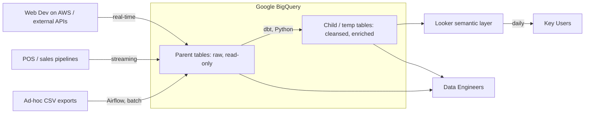

# Session 1 — Exercise 2: Data Architecture Diagnosis & 12-Month Roadmap at Cartier (luxury retail)

LUBERNE Féliz

## 1. Diagnosis: data flow matrix

Cartier's data environment is fragmented across business units, geographic
regions and departments. While the Digital Web Development team (France)
operates on AWS, the Analytics & Data Engineering team relies exclusively on
Google Cloud Platform (GCP).

Data is ingested through two primary mechanisms:

- **Standardized ingestion (real-time / recurring):** API calls and streaming sales pipelines fed directly into the cloud warehouse.
- **Ad-hoc ingestion (batch):** occasional CSV files integrated and orchestrated via Apache Airflow.

Storage is central: all raw and transformed data lands in Google BigQuery.
Schema modeling and structural transformations are done with dbt, and advanced
data processing runs through Python scripts. At the end of the chain, the
semantic layer configuration and dashboard migrations are managed in Looker
through version-controlled configuration files (`.lkml`, `.yml`, `.json`).

We enforce a strict strategy of **read-only parent tables**. Pristine raw parent
tables are never directly modified: all modifications, enrichments and ad-hoc
logic generate temporary or child tables linked back to the unmodified parent
table.

The main consumers are Data Engineers (during development, scripting and
pipeline maintenance) and Key Users (consuming daily operational Looker
dashboards).

| # | Source system | Data category | Consumer | Frequency | Format / protocol |
|---|---------------|---------------|----------|-----------|-------------------|
| 1 | Web Dev (AWS) / external APIs | Generic app logs, web data | Google BigQuery | Continuous / real-time | REST APIs / streaming ingestion |
| 2 | Point of Sale (POS) / sales pipelines | Sales transactions | Google BigQuery | Continuous | Real-time streaming |
| 3 | Ad-hoc business exports | CSV spreadsheets | Google BigQuery | Ad-hoc / batch | Apache Airflow → BigQuery |
| 4 | Google BigQuery (parent tables) | Raw immutable data | Data Engineers & dbt | On demand | SQL / dbt models |
| 5 | Google BigQuery (child / temp tables) | Cleansed & enriched tables | Python scripts / Looker | Automated / frequent | Python / `.lkml`, `.yml`, `.json` |
| 6 | Looker layer | Key metrics & reports | Key Users (business) | Daily | Looker dashboards |
| 7 | BigQuery & LookML repository | Schemas, pipelines, code | Data Engineers | Continuous / dev | SQL / Python / LookML |

## 2. Architecture classification & justification

The current platform is classified as a **modern cloud data warehouse with an
ELT architecture** (GCP-based).

- **Workload:** designed primarily for Business Intelligence (BI) and operational reporting. It strictly segregates pipeline engineering and maintenance (Data Engineers) from daily dashboard consumption (Key Users).
- **Data types:** handles structured transactional data (sales, API payloads) along with semi-structured files (ad-hoc CSV exports, `.json` / `.yml` metadata files).
- **Freshness:** hybrid model combining real-time streaming for sales pipelines with batch processing for ad-hoc CSV integrations and dbt transformations.
- **Governance & immutability:** the architectural enforcement of read-only parent tables ensures data lineage, auditability and protection of raw historical facts.

## 3. Key problems & 12-month target evolution path

### Four key identified problems

1. **Operational overhead & manual edge-case management:** with the team in its first year, initial efforts focused heavily on foundational setup, key-user enablement and handling edge cases manually, leaving pipeline automation as an urgent necessity.
2. **Dual analytical infrastructure (Azure & GCP):** the ongoing global transition from Azure to GCP creates temporary pipeline duplication, dual infrastructure costs and migration complexity.
3. **Ad-hoc CSV ingestion risks:** manual CSV imports via Airflow lack automated schema checks and data-masking guardrails, risking downstream dbt pipeline failures or sensitive data exposure.
4. **Temporary table proliferation:** the frequent creation of child and temporary tables without automated Time-To-Live (TTL) deletion rules increases BigQuery storage costs and clutters the data catalog.

### 12-month target evolution roadmap

| Step | What changes | Criterion | What it makes possible |
|------|--------------|-----------|------------------------|
| **1. Ingestion automation & migration acceleration** (months 1 to 4) | Transition from manual edge-case handling to fully automated Airflow DAGs with embedded schema validation and automatic PII masking for incoming Azure-to-GCP data flows. | **Team & skills** (enabling a young team to scale without being consumed by maintenance) and **workload**. | Eliminates daily manual ingestion fixes, allowing the team to focus on leading the global group migration from Azure to GCP. |
| **2. Automated data quality (dbt CI/CD) & storage governance** (months 5 to 8) | Implement automated dbt testing via CI/CD pipelines to validate data quality on every deployment, alongside automated TTL purging rules for temporary BigQuery tables. | **Governance** and **cost**. | Replaces manual data quality checks with automated guardrails and prevents BigQuery storage cost escalation as migration volumes increase. |
| **3. Unified semantic layer & Azure decommissioning** (months 9 to 12) | Standardize group-wide KPI definitions in dbt / LookML for all global entities, automate Looker dashboard deployments, and fully shut down legacy Azure analytics components. | **Cost** and **workload**. | Enables total decommissioning of legacy Azure analytics infrastructure (drastically reducing duplicate cloud spend) while delivering automated, single-source-of-truth reporting to all key users worldwide. |
