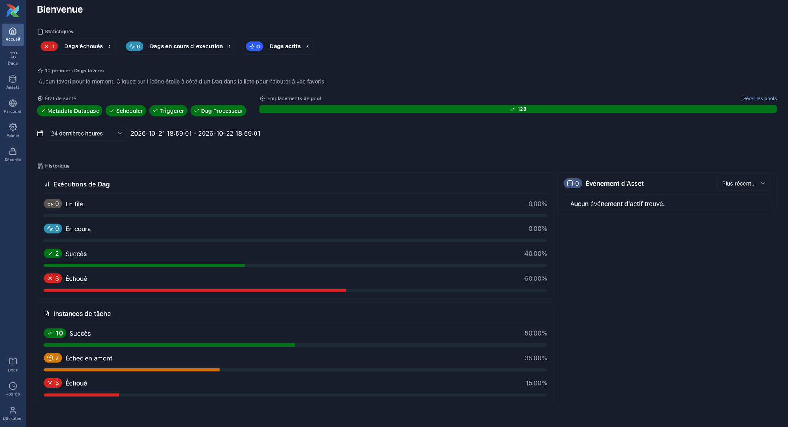

# Session 7 — Exercise 1: schedule it, break it, fix it

LUBERNE Féliz — written as a group. Airflow 3.3.2 with the Docker provider, running locally from `scriptes/l07/`. The DAG is `scriptes/l07/dags/exercise_feliz.py` and writes to the BigQuery dataset `data-engineering-i2.l07_ex_fl`. We used the course's published images (`charlestng/albert-extractor:2026-09-25`).

## 1. Where things are in the UI

| What | Where we found it |
|---|---|
| The list of DAGs, and the pause switch | "Dags" in the left menu; each DAG has its switch on its own row, left of the ▶ button |
| The graph of a DAG's tasks | On the DAG's page, the graph icon at the top left, next to the grid view |
| The log of one task, in one run | Click the task's square in the grid (or the task in a run's list), then the "Journaux" (logs) tab, one sub-tab per attempt |
| The rendered value of a template variable | Same task instance, the "Rendered Templates" tab: it shows what `{{ data_interval_start \| ds }}` became for that run |

One catch: runs started with `airflow dags test` print their logs in the terminal and do not appear in the UI ("Log file not found on worker").



Airflow's home page at the end of the exercise: the four components (metadata database, scheduler, triggerer, DAG processor) are healthy, and no DAG is active, since we paused both once we had finished.

## 2. Our DAG

Four tasks: `extract_order_items` and `extract_product` run the extractor image with `TABLE=order_items` and `TABLE=product`; `load` lands both files in staging tables and merges them into `order_items_raw` and `product_raw`; `drop_staging` drops the two staging tables.

The line that makes the two extracts run at the same time is `[extract_order_items, extract_product] >> load >> drop_staging`: a list on the left of `>>` means no edge between its members, so they start together and `load` waits for both. `drop_staging` has `trigger_rule="all_done"`, so the scratch tables are dropped even when the load fails.

We left `SINCE` out of both extracts: neither table has a date, and for tables this size taking the whole table each run is honest. It is also what makes the load's behaviour on a re-run visible.

The full DAG file is in the repository (`scriptes/l07/dags/exercise_feliz.py`); its load step after step 5:

```sql
MERGE l07_ex_fl.product_raw t
USING l07_ex_fl.product_stage s
ON t.p_id = s.p_id
WHEN MATCHED THEN UPDATE SET
  p_name = s.p_name, p_desc = s.p_desc, price = s.price,
  qty = s.qty, category_id = s.category_id
WHEN NOT MATCHED THEN INSERT ROW;

MERGE l07_ex_fl.order_items_raw t
USING l07_ex_fl.order_items_stage s
ON t.order_id = s.order_id AND t.p_id = s.p_id
WHEN MATCHED THEN UPDATE SET
  qty = s.qty, price_at_purchase = s.price_at_purchase
WHEN NOT MATCHED THEN INSERT ROW;
```

## 3. The first run

| | Rows the extractor reported | Rows in our bronze table |
|---|---|---|
| `order_items` | 409,609 | 409,609 |
| `product` | 42,859 | 42,859 |

They agree. Both are above the original export (408,560 and 42,858): the company database is live, with the load generator adding orders since lesson 3 and one test product we inserted in lesson 3.

The interesting part is the run's overall state. Our first `load` failed three times (we had written `--decimal_target_types=NUMERIC,BIGNUMERIC`, and `bq` takes one value per flag), yet the run was shown as **Success**. Airflow sets a run's state from its last tasks, and the last one, `drop_staging`, ran with `all_done` and succeeded. So the trigger rule that keeps the bill clean also hides the failure: anybody reading the run list would think the data had landed. Declaring `drop_staging` as a teardown task (`drop_staging.as_teardown()`) keeps it running on failure without letting it decide the run's state.

## 4. Breaking it on purpose

| `product_raw` | Rows in bronze | Distinct `p_id` |
|---|---|---|
| Before clearing | 42,859 | 42,859 |
| After clearing `load` | 85,718 | 42,859 |

Every product is now in the table twice, so any count, average or join built on it is doubled, and no task went red to say so.

## 5. The fix

We fixed both tables, measured on `product_raw`: a `MERGE` on `p_id` for products and on `(order_id, p_id)` for order lines (SQL above). After `TRUNCATE`:

| `product_raw` | Rows in bronze | Distinct `p_id` |
|---|---|---|
| After the first run | 42,859 | 42,859 |
| After clearing and re-running | 42,859 | 42,859 |

The line that fixed it: `MERGE l07_ex_fl.product_raw t USING l07_ex_fl.product_stage s ON t.p_id = s.p_id … WHEN NOT MATCHED THEN INSERT ROW`.

## 6. Back-fill

| | Rows in `product_raw` |
|---|---|
| Our prediction, written before | 128,577 (three runs × 42,859: we expected each day to add the table again) |
| What actually happened | 42,859 (and 409,609 in `order_items_raw`) |

The dry run listed three runs, 2026-10-10 to 2026-10-12. Each one extracted the whole table again, and the merge matched every row it already had, so three full extracts added nothing. We ran it with `--max-active-runs 1` on purpose: in the demo, a back-fill whose days ran in parallel failed, because every run writes the same `out/orders.parquet` and one run's extract overwrote the file while another run's load was reading it. The merge makes a run safe to repeat; it does not make two runs safe at the same time. A file name per interval (`product_{{ ds }}.parquet`) would.
